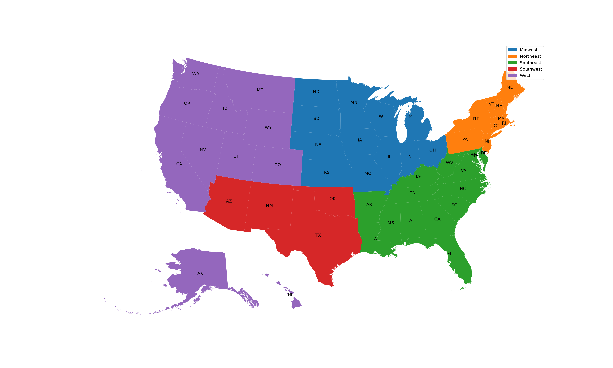

# Socioeconomic and Racial Factors Influencing Larceny Rates in U.S. Regions

An analysis of how income, poverty, employment and racial composition relate to larceny rates in
2,215 U.S. communities, and how well machine learning models can predict those rates across five
regions of the country.

This was the final project for **DTSC 3601/3602: Predictive Analytics and Their Implications** at
the University of North Carolina at Charlotte (December 2024). The full paper is in
[`paper/`](paper/).



## Key findings

- **Larceny is the most common crime in the dataset**, accounting for about 53% of all reported
  crimes.
- **Income and racial composition show the strongest correlations.** Median income has the
  strongest correlation with larceny rates (-0.45), followed by the percentage of Black residents
  (`racepctblack`, +0.36), the percentage of White residents (`racePctWhite`, -0.32) and the
  unemployment rate (`PctUnemployed`, +0.29). These are correlations, not causes: in 1990s data,
  racial composition is closely tied to income and poverty, so these features overlap.
- In the Random Forest model, the most important predictors were median income (0.24), the number
  of people below the poverty line (0.19) and `racepctblack` (0.12).
- **Larceny rates vary by region.** The Southeast has the highest average rate and the Northeast
  has the lowest.
- **Random Forest performed best** of the regression models, though predicting larceny from these
  features alone is difficult (R² of about 0.31).

| Model | Task | Result |
|---|---|---|
| Logistic Regression | Above or below the median larceny rate | 77% test accuracy (73% cross-validated) |
| Linear Regression | Larcenies per 100K population | R² = 0.24 |
| Random Forest | Larcenies per 100K population | R² = 0.31 |
| K-Means (k = 3) | Grouping communities by socioeconomic profile | Silhouette score = 0.33 |

## Repository structure

```
├── data/                      # Datasets and their sources (see data/README.md)
├── figures/                   # Figures saved by the notebook
├── notebooks/
│   └── larceny_analysis.ipynb # Full analysis
├── paper/                     # Final paper (PDF)
├── scripts/
│   └── make_dataset.py        # Converts the raw UCI download into data/crimedata.csv
└── requirements.txt
```

## How to run it

1. **Create a virtual environment** with [uv](https://docs.astral.sh/uv/) (tested with Python 3.12):
   ```
   uv venv --python 3.12
   ```
2. **Activate it.** On Windows (PowerShell):
   ```
   .venv\Scripts\activate
   ```
   On macOS or Linux:
   ```
   source .venv/bin/activate
   ```
3. **Install the requirements:**
   ```
   uv pip install -r requirements.txt
   ```
4. **Run the notebook.** Open `notebooks/larceny_analysis.ipynb` and run all cells. The figures
   are saved to `figures/`. Figure numbers match the paper, so Figures 10 and 11 appear in the
   notebook before Figures 7 to 9. `fig00_crime_type_totals.png` isn't in the paper.

## Data

- **[Communities and Crime Unnormalized](https://archive.ics.uci.edu/dataset/211/communities+and+crime+unnormalized)**,
  UCI Machine Learning Repository. Combines socioeconomic data from the 1990 U.S. Census, police
  data from the 1990 LEMAS survey and crime data from the 1995 FBI Uniform Crime Reports.
- **[2018 Cartographic Boundary Files](https://www.census.gov/geographies/mapping-files/time-series/geo/carto-boundary-file.html)**,
  U.S. Census Bureau (state boundaries for the regional map).

As the dataset's creators note, these figures are from the 1990s and leave out many factors that
affect crime, so the results describe patterns in this data rather than causes.

## Methods

- Grouped communities into five regions (Northeast, Southeast, Midwest, Southwest, West).
- Selected nine features based on Social Disorganization Theory and Strain Theory: population,
  median income, number below the poverty line, racial composition (four features), and
  unemployment and employment rates.
- Trained CART, Random Forest and Gradient Boosting models separately for each region, tuning tree
  depth with cross-validation, and compared them against a mean-value baseline. The baseline uses
  the national mean and is scored on the whole dataset, so in Figure 6 compare the regions by R²:
  MSE and MAE aren't directly comparable between the baseline and each region's test set.
- Compared Logistic Regression, Linear Regression and Random Forest on the full dataset.
- Used K-Means clustering to find groups of communities with similar socioeconomic profiles. One of
  the three clusters contains only New York City: `population` and `NumUnderPov` are raw counts,
  and New York's are so much larger than any other community's that it forms its own cluster.

## Notes on reproducing the paper

The code was originally written in [Hex](https://hex.tech), a cloud-based data notebook
platform, and has been cleaned up to run locally.

A few differences from the submitted paper:

- **Silhouette score:** the paper reports 0.53, but the original code printed 0.33, which this
  notebook reproduces. The paper's figure appears to be a typo.
- **Naive Bayes:** Table 3 in the paper lists a Naive Bayes model, but the code for that row
  actually trained a second Random Forest, which is why the two rows have identical results. It
  has been removed from the notebook.
- **Random Forest MSE** is about 2.51M here (2,513,563.71 vs. 2,514,378.05 in the paper). The small
  difference comes from the scikit-learn version.
- **Logistic Regression accuracy** is 77.20% here vs. 76.75% in the paper. The original code didn't
  scale the features before fitting, so the model never fully converged. This version scales them
  first, as the paper's methods section describes.

## Authors

Kenny Shibu, Jonathan Hutteman, Lidya Mehari and Mahader Zeru

Course instructors: Dr. Nadia Najjar and Dr. Shannon Reid
